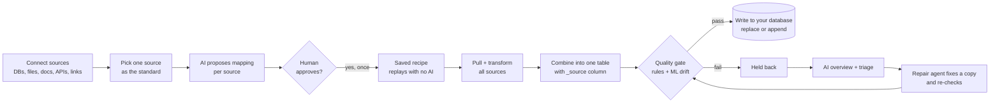
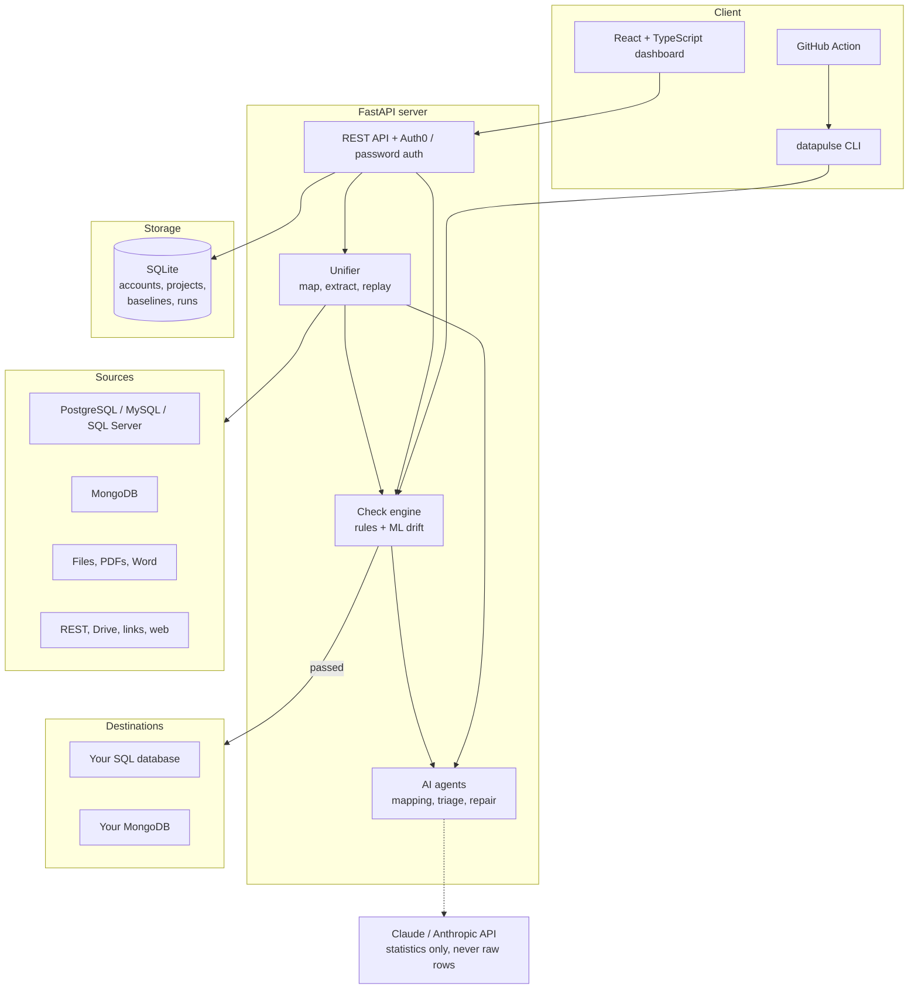

# DataPulse

**Unify data from any database into one clean, trusted table, and block bad data before it breaks a dashboard or model.**

[](https://github.com/webodox/Datapulse/actions/workflows/tests.yml)


[Live demo](https://datapulse-production-743a.up.railway.app) (invite-only sign-in via Auth0) ·
[Quick start](#quick-start) · [Architecture](#architecture) · [Pipeline](#pipeline)

---

## The problem

Companies keep the same kind of data in many places: a warehouse in PostgreSQL, a store system in MySQL, spreadsheets
and PDFs from partners. Each source names columns differently, stores amounts in different units (cents vs. dollars),
formats values its own way, and drifts over time. Teams spend hours hand-writing mapping scripts, and a silent schema
or distribution change still reaches dashboards and ML models.

## The solution

DataPulse connects to each source, uses **Claude** to propose how to convert it to your standard format, validates
the combined result with **deterministic rules and a local ML drift model**, and writes it to your own database.
**Data that fails its checks is held back and never written.**

## Highlights

| Capability | What it does |
|---|---|
| **Multi-source ingestion** | PostgreSQL, MySQL/MariaDB, SQL Server, MongoDB, any SQLAlchemy database, CSV/Excel/JSON/Parquet, PDFs and Word docs, REST APIs, Google Drive/Sheets, public links and web pages. |
| **AI schema mapping** | Claude proposes renames, unit conversions, text-to-number casts and spelling fixes, each with a reason. A human approves once, then the recipe **replays with no AI call**. |
| **Layered data checks** | Schema, nulls, row counts, duplicates, categories and distributions run offline and deterministically. |
| **ML drift detection** | A random forest tries to tell new rows from trusted rows. Its out-of-bag ROC AUC is the drift score, and feature importance names the columns that changed. It catches multi-column shifts that per-column rules miss. |
| **Triage and repair agents** | Claude agents with read-only tools triage failures (block, investigate or ship). A repair agent fixes a *copy* of the data using a fixed set of safe operations and re-runs every check to prove it worked. |
| **Safe by design** | Quality gate before writes, atomic SQL loads, read-only source queries, secrets kept server-side, and only aggregate statistics ever sent to the LLM. |
| **Polyglot impact analysis** | `datapulse scan` finds which files, in 16 languages, read a dataset and reference its columns, so reports say what a data change may break. |
| **CI/CD gate** | A composite GitHub Action checks data files in pull requests and compares them against the *base branch's* baseline and rules, so a PR can't loosen its own thresholds. |
| **Ships three ways** | Web dashboard + REST API, CLI, or GitHub Action, deployable with Docker, as a single cloud container, or as a standalone binary with no Python needed. |

## Pipeline



1. **Connect sources** by connection URL, upload, link, Google Drive, REST API or web page.
2. **Pick the standard.** One source's columns, types and value scales become the baseline.
3. **Map the others.** Columns whose names match are mapped automatically, and Claude proposes the rest from
   statistics only. A person reviews and approves.
4. **Unify.** Every pull replays the approved recipe, validates the result, and combines sources into one table. If a
   source changes shape so a step no longer applies, the run says so instead of guessing.
5. **Gate and deliver.** Passing data is written to your destination table in a single transaction. Failing data is
   held back with an AI overview of what went wrong and where to look first.

## Architecture



**Design decisions worth noting**

- **AI proposes, rules decide.** The LLM suggests mappings and explanations, but a pass/fail verdict only comes from
  deterministic checks and the local ML model. AI output never changes a result.
- **Replay without AI.** An approved mapping becomes a stored recipe, so production loads are reproducible, cheap and
  not dependent on an LLM being reachable.
- **Constrained agents.** Agents can only call a fixed set of safe operations (rename, rescale, convert to numbers,
  deduplicate, fill or drop empties, standardize spellings). They never execute arbitrary code.
- **Privacy first.** Only column names and aggregate statistics go to the API. Tests enforce that raw rows and
  category values are never sent.
- **Plug-in connectors.** A new source type is one file in `src/datapulse/sources/` with a `@register` decorator, and
  it appears in the dashboard automatically.
- **Core library, thin surfaces.** The CLI, REST API and GitHub Action all run the same check engine and produce the
  same JSON report.

## Tech stack

| Layer | Technology |
|---|---|
| Backend | Python 3.10+, FastAPI, pandas, NumPy, SQLAlchemy, Typer, Rich |
| AI | Claude (Anthropic API) with tool use |
| ML | scikit-learn random forest drift model, runs locally with no API key |
| Frontend | React, TypeScript, Vite |
| Data stores | SQLite for app data. PostgreSQL, MySQL/MariaDB, SQL Server and MongoDB as sources and destinations |
| Auth | Auth0 (OpenID Connect with PKCE) or built-in scrypt-hashed passwords, with HttpOnly session cookies |
| DevOps | Docker, Docker Compose, GitHub Actions, PyInstaller standalone binary, Railway |
| Testing | pytest (180+ tests across checks, connectors, server, auth, CLI and the GitHub Action) |

## Quick start

### Docker (recommended)

```bash
git clone https://github.com/webodox/Datapulse.git
cd Datapulse
cp .env.example .env          # optional: add ANTHROPIC_API_KEY and Auth0 values
docker compose up --build
```

- Dashboard: http://localhost:8080
- API docs (OpenAPI): http://localhost:8000/docs

The first person to sign in becomes the admin and can add teammates. In the dashboard, click
**Try it with sample data** to get three sample databases (a warehouse, a store system that keeps amounts in cents,
and a shop that stores prices as text) ready to map and unify.

### Without Docker (Python 3.10+, Node.js 20+)

```bash
pip install -e ".[web,sources]"
uvicorn server.app:app --reload --port 8000

cd web && npm install && npm run dev      # http://localhost:5173
```

### CLI

```bash
pip install -e ".[dev]"

datapulse baseline examples/data/orders.csv -c examples/datapulse.yml
datapulse check examples/data/orders_drifted.csv -c examples/datapulse.yml
```

Exit codes: `0` passed, `1` issues found, `2` bad input. Run `datapulse --help` for every command
(`baseline`, `check`, `scan`, `suggest`, `draft-rules`, `fix`, ...).

AI features need `ANTHROPIC_API_KEY`. Everything else, including the ML drift model, works without it.

## Data checks

| Check | What it catches |
|---|---|
| `schema` | Added, removed or retyped columns |
| `row_count` | Unexpected volume changes |
| `null_rate` | Columns that suddenly go empty |
| `categorical` | New or missing category values |
| `duplicates` | Duplicate keys and abnormal whole-row duplicate rates |
| `distribution` | Shifted value ranges, such as dollars becoming cents |
| `ml_drift` | Subtle and multi-column drift, with the responsible columns named |

Rules live in a `datapulse.yml` file (see [`examples/datapulse.yml`](examples/datapulse.yml)). You can also declare
**downstream consumers** (dashboards, models) so a failing column lists exactly who is affected, and you can draft
rules in plain English with `datapulse draft-rules "..."`.

## GitHub Action

Gate data changes in pull requests:

```yaml
permissions:
  contents: read
  pull-requests: write
steps:
  - uses: actions/checkout@v4
  - uses: webodox/Datapulse@main
    with:
      data-file: data/orders.csv
```

It compares the PR's data against the baseline and rules on the **base branch** (so a PR can't re-baseline itself
past the gate), posts a single updating PR comment, writes a job summary, and fails the job when issues reach the
configured severity. It runs in an isolated virtualenv, so it works in any language's repository. See
[`action.yml`](action.yml) and [`examples/workflows/`](examples/workflows/).

## Security

- Connection URLs, passwords and API headers stay on the server and are never returned to the browser or shown in
  errors.
- Source queries are read-only: a table name becomes `SELECT * FROM table`, anything else must be a single `SELECT`,
  and it runs in a rolled-back transaction. SQLite paths are restricted to a configured folder, and link sources must
  be public `https://` addresses.
- Destination writes touch one named table and run in a single transaction: all rows or none.
- Passwords are scrypt-hashed and sessions are HttpOnly cookies. Every API route requires sign-in except health and
  the key-authenticated `/ingest` endpoint. Per-source row reads are capped (`DATAPULSE_MAX_SOURCE_ROWS`).

## Deployment

`Dockerfile.app` packages the dashboard and API into one container with data on a volume at `/data`, and
`railway.json` configures a one-click [Railway](https://railway.com) deploy with a `/api/health` check.

1. Create a Railway project from this repo.
2. Set `ANTHROPIC_API_KEY` and `DATAPULSE_SECURE_COOKIES=1` (plus the Auth0 values if you use Auth0).
3. Attach a volume at `/data`, then generate a domain.

Any host that runs a Dockerfile and offers a persistent volume works the same way.

### Configuration

| Variable | Purpose |
|---|---|
| `ANTHROPIC_API_KEY` | Turns on the AI features |
| `ANTHROPIC_WORKSPACE_ID` | Only if your key isn't tied to a workspace |
| `AUTH0_DOMAIN`, `AUTH0_CLIENT_ID`, `AUTH0_CLIENT_SECRET` | Optional Auth0 sign-in (callback: `https://<site>/api/auth/callback`) |
| `DATAPULSE_HOME` | Where app data is stored (default `.datapulse/`) |
| `DATAPULSE_SECURE_COOKIES=1` | Set when served over HTTPS |
| `DATAPULSE_MAX_SOURCE_ROWS` | Rows read per source pull (default 200,000) |

## Project structure

| Path | Contents |
|---|---|
| `src/datapulse/` | Core library and CLI: checks, ML drift, AI agents, repair, impact scan |
| `src/datapulse/sources/` | One file per source connector |
| `src/datapulse/unifier/` | Mapping, extraction and recipe replay that unify sources into one table |
| `server/` | FastAPI app, auth, storage and destinations |
| `web/` | React + TypeScript dashboard |
| `tests/` | pytest suite |
| `examples/` | Sample data, rules, workflows and a multi-language sample repo |
| `action.yml`, `.github/workflows/` | GitHub Action and CI |

## Development

```bash
pip install -e ".[dev,web]"
pytest -q                                   # backend tests
cd web && npm install && npm run build      # type-check and build the dashboard
```

CI runs the test suite on Python 3.10 and 3.12 for every push and pull request.

## License

[MIT](LICENSE)
